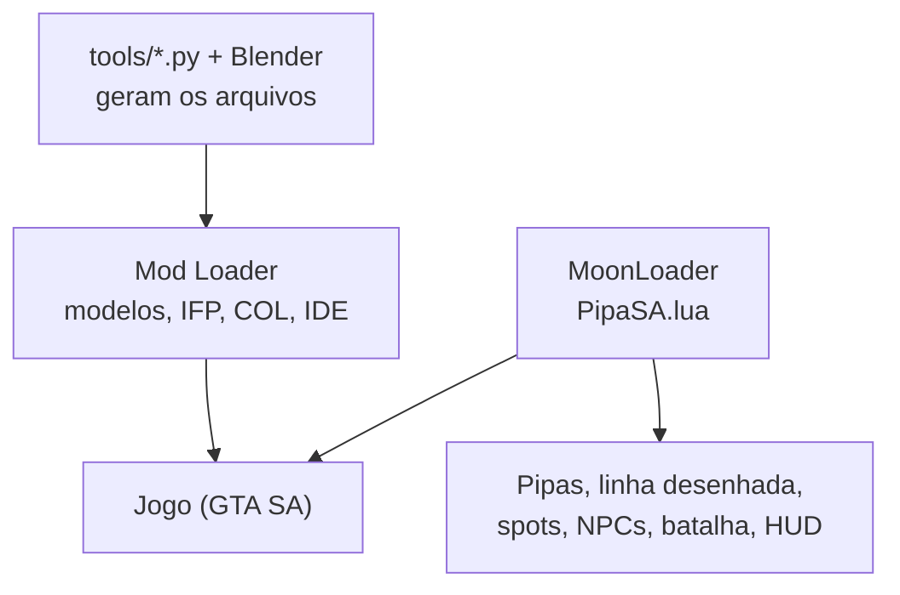

<div align="center">


# PipaSA

*Mod de GTA San Andreas com batalha de pipas (corte de linha), pipas no céu da cidade e jogadores de pipa espalhados pelo mapa.*

</div>

<p align="center">
  
  
  
</p>

| | |
| --- | --- |
| **Versão** | 0.1 |
| **Estado** | Protótipo jogável: modelos, spots, props, animações e ícone funcionam no jogo; as mudanças mais recentes (corpo do CJ virando para a pipa, pipa pequena na mão) ainda não foram testadas |
| **Contexto** | Projeto pessoal, inspirado no jogo *CS Diamantes Pipas* (ver [engenharia reversa](docs/engenharia-reversa.md)) |
| **Licença** | [MIT](LICENSE) |
| **Alvo** | GTA San Andreas 1.0 US (HOODLUM, exe de 14.383.616 bytes) com MoonLoader e Mod Loader |

> **Limite principal:** feito e testado em **uma** instalação (a do autor). Coordenadas dos spots são aproximadas, o jogo online do original (loja, ranking, voz) não existe aqui, e nada foi testado em outras versões do GTA SA.

## Sumário

[Início rápido](#início-rápido) · [1. Objetivo](#1-objetivo) · [2. Como jogar](#2-como-jogar) · [3. Arquitetura](#3-arquitetura) · [4. Estrutura](#4-estrutura-do-repositório) · [5. Instalação](#5-instalação) · [6. Ferramentas](#6-ferramentas) · [7. Critérios de aceite](#7-critérios-de-aceite) · [8. Escopo](#8-limites-de-escopo-e-evolução) · [9. Documentação](#9-documentação-complementar) · [10. Autor e licença](#10-autor-e-licença)

## Início rápido

Requer GTA SA 1.0 US com [MoonLoader](https://blast.hk/moonloader/) e [Mod Loader](https://github.com/thelink2012/modloader) (testado com Mod Loader 0.3.10 e fastman92 Limit Adjuster 6.5). Python 3 para gerar o `gta.dat`.

```bash
# 1. gere o gta.dat (cópia do seu gta.dat + 2 linhas do mod)
python tools/make_gta_dat.py "D:/Games/GTA San Andreas" modloader/PipaSA/data/gta.dat
# 2. copie o script e o mod para o jogo
cp moonloader/PipaSA.lua "D:/Games/GTA San Andreas/moonloader/"
cp -r modloader/PipaSA "D:/Games/GTA San Andreas/modloader/"
```

Entre no jogo, vá até um ícone de pipa no radar (ou digite `PIPA`) e aperte `K`. O ícone do radar é opcional: veja [Instalação](#5-instalação).

## 1. Objetivo

Trazer para o GTA SA a mecânica de batalha do *CS Diamantes Pipas*, jogadores de pipa em lugares abertos e periferias de Los Santos, e o CJ soltando pipa.

**Não faz:** multiplayer, loja de diamantes, anúncios, chat/voz, nem copia assets do jogo original.

### Entregas da versão

- Pipa do CJ que segue a direção da câmera, com elevação limitada para não ir ao chão nem ao zênite.
- Batalha de linha contra NPCs: cruzar as linhas tira vida das duas; quem zera tem a pipa cortada e cai com o vento.
- 9 spots em Los Santos com blip no radar e cena ao redor (bancos, mesas, gente sentada, conversando e soltando pipa sozinha).
- Modelos próprios (pipa em 4 cores, laços da rabiola, carretel), animações próprias para o CJ e para pedestres, e ícone do radar.

## 2. Como jogar

| Tecla | Ação |
| --- | --- |
| `K` | pega a pipa na mão (ou recolhe a pipa que está no ar) |
| `Y` (segurar) | solta linha: a pipa sobe e se afasta |
| `H` (segurar) | recolhe linha; recolhendo tudo, a pipa volta para a mão |
| `J` | chicote: dano forte por ~1 s, recarga de 6 s |
| `U` | desafia o jogador de pipa mais próximo (até 15 m) |
| câmera | direciona a pipa (como a mira) |
| digitar `PIPA` | mostra a ajuda e as informações por 25 s |

As teclas podem ser trocadas em `moonloader/config/PipaSA.ini` (criado na primeira execução). `G` ficou de fora de propósito: no GTA é "entrar de carona".

**Regras da batalha:** cada linha começa com 100 de vida. Quando as duas linhas se cruzam (raio de 2,2 m) cada uma perde vida por segundo; puxar ou dar linha e o chicote aumentam o dano, o vento forte também. Vencer dá US$ 500 e 25 pontos de rank (Bronze, Prata com 100, Ouro com 300; salvo em `moonloader/config/PipaSA.txt`).

As informações na tela ficam ocultas e só aparecem a até 70 m de um spot ou ao digitar `PIPA`; as dicas usam a caixa de ajuda padrão do GTA.

## 3. Arquitetura



O script faz toda a lógica a cada quadro: posição das pipas (vento, câmera, comprimento da linha), rabiola (5 laços seguem a pipa com atraso), linha desenhada na tela (`renderDrawLine`), spots que aparecem a menos de 45 m do jogador e a IA do rival. O Mod Loader entrega os modelos (IDs 19100 a 19107), colisão, animações e a linha do `gta.dat`.

### Stack tecnológica

| Área | Escolha | Papel |
| --- | --- | --- |
| Lógica do mod | Lua (MoonLoader, LuaJIT/FFI) | pipas, batalha, spots, HUD |
| Posição da mão | FFI para a função do jogo em `0x5E01C0` (posição de osso, a mesma que o CampingMod usa) | carretel e linha saem da mão do CJ |
| Modelos e animações | Python 3 (gerador de DFF/COL/TXD/IFP próprio) | arquivos do Mod Loader |
| Poses das animações | Blender 5.2 + DragonFF | importar o esqueleto, posar, conferir |
| Ícone | PowerShell + Python | PNG 64x64 e troca de textura no `hud.txd` |

## 4. Estrutura do repositório

```text
pipaSA/
├── moonloader/PipaSA.lua          # lógica do mod (vai para <GTA>/moonloader)
├── modloader/
│   ├── PipaSA/                    # modelos, COL, IFP, IDE (vai para <GTA>/modloader)
│   └── zz_PipaSA_HUD/            # hud.txd com o ícone do radar (gerado, não versionado)
├── tools/                         # geradores (ver seção 6)
├── assets/                        # imagem-fonte do ícone e versão 64x64
├── icons/pipasa/                  # conjunto de ícones (ico, icns, png, web)
└── docs/                          # engenharia reversa e animações
```

## 5. Instalação

### Pré-requisitos

- GTA San Andreas 1.0 US com [MoonLoader](https://blast.hk/moonloader/) (usa a lib `inicfg` que já vem nele) e [Mod Loader](https://github.com/thelink2012/modloader).
- Python 3 para gerar `gta.dat` (e, opcionalmente, regerar modelos e ícone).

### Passo a passo

1. Gere `modloader/PipaSA/data/gta.dat`: `python tools/make_gta_dat.py "<pasta do GTA SA>" modloader/PipaSA/data/gta.dat`. Ele é **cópia completa** do seu `gta.dat` mais duas linhas; o Mod Loader compara arquivos, então um `gta.dat` só com as linhas novas apagaria o resto do mapa. Por isso não é versionado.
2. Copie `moonloader/PipaSA.lua` para `<GTA>/moonloader/` e a pasta `modloader/PipaSA` para `<GTA>/modloader/`.
3. Abra o jogo. Erros aparecem em `moonloader/moonloader.log`; o carregamento dos modelos em `modloader/modloader.log`.

### Ícone do radar (opcional)

O ícone substitui a textura `radar_light` (blip 56, sem uso no jogo livre) em um `hud.txd` com ícones **64x64** (como os de um pack de HUD em alta resolução; o `hud.txd` original do GTA tem 16x16 e não serve).

```bash
powershell -File tools/prep_icon.ps1 -Src assets/kite_icon_src.png -OutPng assets/kite_icon_64.png -OutRaw assets/kite_icon_64.bgra
python tools/make_hud_txd.py "<hud.txd do seu pack>" assets/kite_icon_64.bgra modloader/zz_PipaSA_HUD/models/hud.txd
```

Copie `modloader/zz_PipaSA_HUD` para `<GTA>/modloader/`. Se outro mod também trocar o `hud.txd`, dê prioridade maior a esta pasta em `modloader/modloader.ini` (`[Profiles.Default.Priority]`, por exemplo `zz_PipaSA_HUD = 99`). Sem o ícone, os spots aparecem com o blip original de `radar_light`.

### Testes

Não há suíte automatizada. As checagens usadas:

```bash
# sintaxe do script, com o LuaJIT do próprio MoonLoader
"<GTA>/moonloader/luajit/bin/luajit.exe" -e "assert(loadfile('moonloader/PipaSA.lua')); print('ok')"
# regerar modelos e conferir a estrutura dos chunks
python tools/make_kite_dff.py modloader/PipaSA
```

## 6. Ferramentas

| Arquivo | Função |
| --- | --- |
| `tools/make_kite_dff.py` | gera os DFF (pipa, laços, carretel), COL, TXD vazio e o IDE |
| `tools/make_gta_dat.py` | gera o `gta.dat` completo com as linhas do mod |
| `tools/ifp.py` | lê e escreve IFP ANP3 (regrava o `ped.ifp` do jogo sem perder quadros) |
| `tools/blender_kite_anims.py` | gera `pipasa.ifp` no Blender (precisa de `work/player.dff`, ver [animações](docs/animacoes.md)) |
| `tools/pose_lib.py` | helpers do Blender (rig, poses, render de esqueleto) |
| `tools/prep_icon.ps1`, `tools/make_hud_txd.py` | ícone 64x64 e troca da textura no `hud.txd` |

Os modelos gerados já estão versionados em `modloader/PipaSA`, então só regere se mudar algo. `work/` guarda arquivos extraídos do seu jogo e não é versionada.

## 7. Critérios de aceite

- [x] Modelos de pipa, laços e carretel carregam no jogo (IDs 19100 a 19107).
- [x] Spots com cena (props, NPCs sentados, conversando, soltando pipa) aparecem no mirante.
- [x] Ícone do radar aparece no mesmo tamanho dos demais.
- [x] Pipa segue a direção da câmera; animações próprias do CJ e dos pedestres rodam.
- [ ] CJ vira o corpo para a pipa e a pipa fica pequena na mão antes de soltar — implementado, **ainda não testado no jogo**.
- [ ] Batalha completa até o fim (cortar e ser cortado) e rank salvo — implementada, validada só em partes.
- [ ] Altura e velocidade da pipa por câmera (mínimo de 18°, +6° da câmera) — ajustados por palpite.
- [ ] Spots em outras regiões além do Mirante Leste — coordenadas aproximadas.

## 8. Limites de escopo e evolução

**Dentro:** modo single player, NPCs como rivais, mecânica de linha e corte inspirada no original.
**Fora:** multiplayer, loja, ranking online, voz.
**Evoluções possíveis:** remover a grama procedural ao redor dos spots (hoje fica como está); animação de torção só do tronco e da cabeça (hoje o CJ vira o corpo todo); linha com oclusão (hoje é desenhada sobre a tela e atravessa prédios); calibrar as coordenadas dos spots e as direções dos bancos no jogo.

## 9. Documentação complementar

- [Engenharia reversa do CS Diamantes Pipas](docs/engenharia-reversa.md) — o que foi analisado e o que é inferência.
- [Animações](docs/animacoes.md) — pipeline Blender + IFP e as convenções de eixo medidas.

## 10. Autor e licença

| Nome | Papel | GitHub |
| --- | --- | --- |
| José Murilo R. Sabalo | autor | [@josemurilors](https://github.com/josemurilors) |

Licença: [MIT](LICENSE). O código e os modelos gerados são do autor; a licença não cobre o GTA San Andreas nem arquivos de packs de terceiros que você usar localmente.

GTA San Andreas é marca da Rockstar Games; este projeto não é afiliado a ela. *CS Diamantes Pipas* é de seus respectivos autores; nenhum asset do jogo foi copiado.
